# NOC Acqua

**Centro de operações de rede para provedor de internet.** Uma aplicação web que transforma o
registro de ordens de serviço em informação gerencial rastreável — e declara a lacuna quando a
fonte não comprova o dado.

> As telas usam dados fictícios de demonstração; nenhum número representa a operação real e
> nenhum nome corresponde a cliente ou colaborador real.

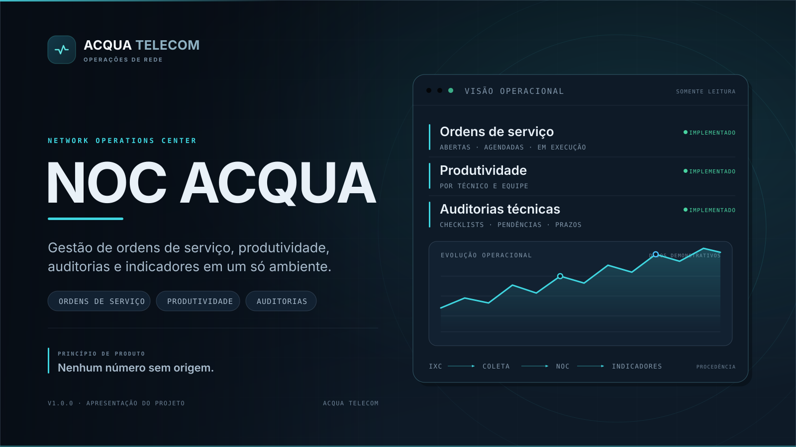

[Por que existe](#por-que-existe) · [O que é](#o-que-é) · [Demonstração](#o-que-a-v100-entrega) · [Como foi construído](#como-foi-construído) · [Desafios](#desafios-superados) · [Qualidade](#qualidade-comprovada) · [Futuro](#o-que-vem-depois) · [Conclusão](#conclusão)

## Por que existe

O NOC Acqua nasceu de uma pergunta simples: **de onde veio este número?** Em um centro de
operações, decisões dependem de indicadores que precisam ser explicados, comparados e defendidos.
Quando cada relatório é montado à mão, a resposta se perde no caminho.

O sistema de gestão registra bem as ordens de serviço, mas não foi desenhado para supervisão. No
dia a dia, isso aparece como:

- indicadores dispersos e planilhas mantidas manualmente;
- dificuldade de distinguir o técnico designado do técnico que executou a visita;
- auditorias de campo sem trilha consultável;
- relatórios montados sob demanda, com risco de inconsistência;
- decisões apoiadas em números que não podem ser rastreados até a origem.

A proposta não é substituir o sistema de gestão. É construir uma camada de leitura que organize
esses registros, preserve a origem de cada número e mostre o que a fonte não comprova.

## O que é

Uma plataforma própria, integrada ao IXC em modo **somente leitura**, que converte o registro
operacional em informação de supervisão. Quatro princípios orientam o desenho:

- **Fonte somente leitura.** O NOC consulta e armazena; nunca escreve no sistema de origem.
- **Procedência em cada número.** Todo indicador informa base, janela de consulta e critério de
  cálculo.
- **Lacuna declarada.** Quando a fonte não sustenta o dado, a ausência é exibida — não preenchida
  por inferência.
- **Teste separado da operação.** Registros sintéticos ficam isolados e não aparecem nas opções
  operacionais.

A V1.0.0 é a primeira versão estável dessa base. O que ainda não existe está declarado no fim
deste documento, separado do que está implementado.

## O que a V1.0.0 entrega

A demonstração começa pelo painel executivo, porque é nele que a proposta fica evidente: cada
número traz a origem, a janela e o critério. Sete módulos concentram a operação. Todos estão
implementados e testados, e as telas abaixo vêm do ambiente demonstrativo isolado, com dados
fictícios identificados na própria interface.

> **Nota sobre o assistente.** A V1.0 utiliza um **assistente operacional determinístico**: as
> respostas são calculadas por regras sobre os dados consultados, com fonte, período e limitações
> declaradas. Não há modelo generativo, aprendizado de máquina nem provedor externo configurado —
> a própria tela informa "Sem IA generativa". Na interface, o módulo aparece como **I.A. do NOC**.
> **IA generativa avançada pertence ao roadmap futuro**, descrito em
> [O que vem depois](#o-que-vem-depois).

### Painel executivo

**Problema.** Saber como o dia está exigia cruzar o sistema de gestão com planilhas e consultas
feitas à mão.

**Contribuição.** Reúne abertura, andamento e encerramento do período em uma leitura única, com
situação atual, evolução semanal, assuntos predominantes, origem do dado e horário da última
leitura. O estado de homologação da fonte fica visível na mesma tela.

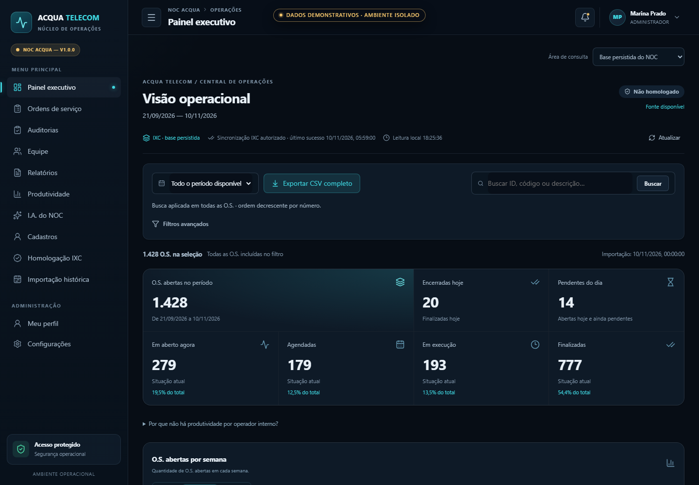

### Ordens de serviço

**Problema.** Localizar uma O.S. e entender seu estado exigia filtros pensados para cadastro, não
para supervisão.

**Contribuição.** Consulta paginada com busca por número, assunto ou técnico, filtros por período,
equipe, técnico e situação, detalhe somente leitura e exportação CSV da seleção. A tela declara
que a designação não comprova a execução.

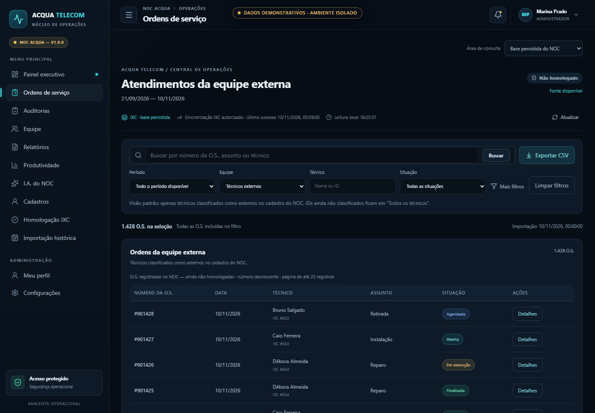

### Produtividade

**Problema.** Comparar técnicos sem confundir quem recebeu a ordem com quem efetivamente executou
a visita.

**Contribuição.** Distribuição por técnico externo e por equipe, assuntos predominantes e
conferência dos totais. O painel informa que a atribuição não é ranking de execução e não calcula
percentual sem denominador válido.

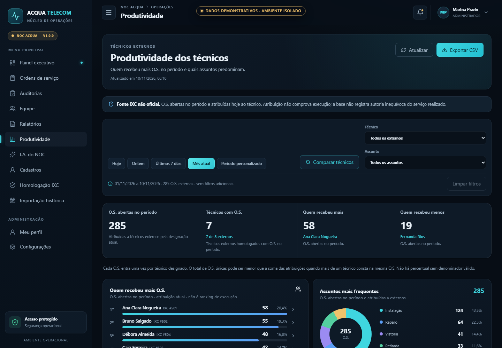

### Equipe

**Problema.** O cadastro de pessoas vivia separado dos identificadores usados pelo sistema de
origem.

**Contribuição.** Cadastro com categorias, homologação e vínculo canônico com os IDs de origem.
Só profissionais homologados entram nos indicadores; o pessoal interno mantém o vínculo de origem
sem receber vínculo de técnico.

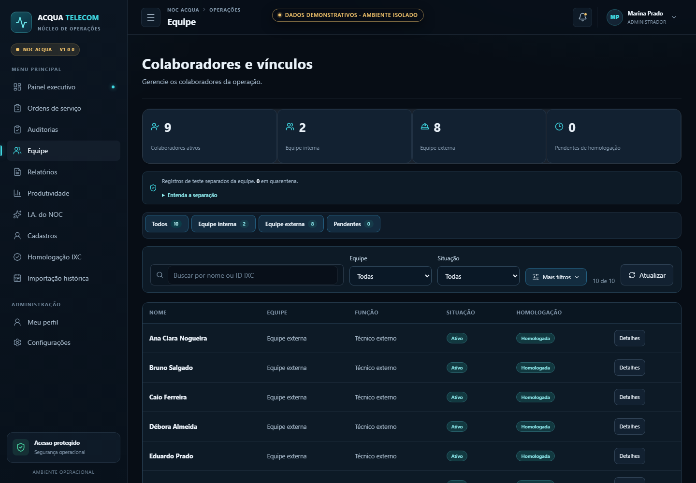

### Auditorias

**Problema.** Auditorias de campo terminavam em registros sem trilha consultável.

**Contribuição.** Checklists, evidências, não conformidades, prazos, conclusão e reabertura, com
resumo de encerradas e pendentes e busca por O.S. O painel de Suporte N2 é condicionado à autoria
comprovada na origem.

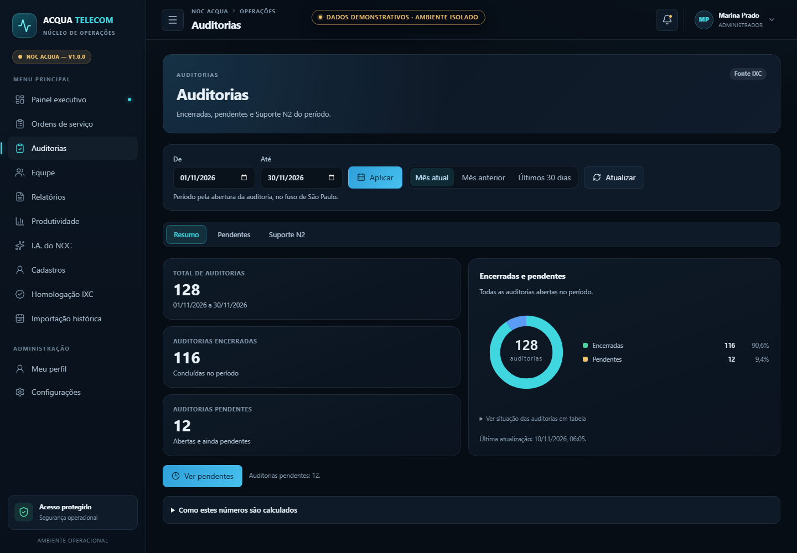

### Relatórios

**Problema.** Relatórios gerenciais eram montados sob demanda e podiam divergir entre áreas.

**Contribuição.** Três agrupamentos — por técnico, por assunto e por situação — sobre os mesmos
filtros e com exportação CSV. Os totais são conciliáveis com o painel e com a lista de ordens.

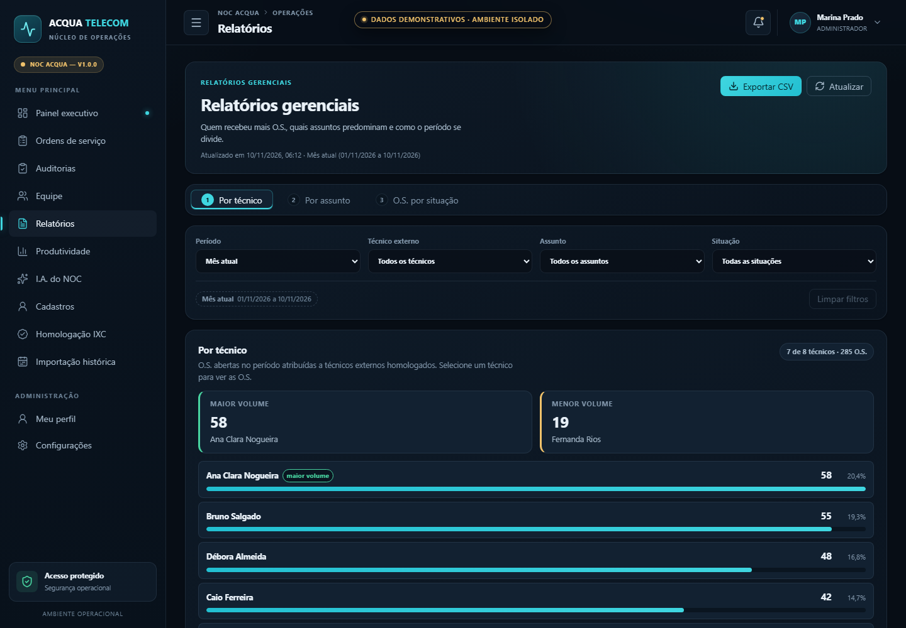

### Assistente do NOC

**Problema.** Responder "como está a operação hoje?" exigia saber em qual tela procurar.

**Contribuição.** Interpretação determinística de perguntas em português — sem modelo generativo —,
com fonte, período e limitações em cada resposta. O histórico da conversa fica apenas na aba e não
envia dado pessoal para a URL.

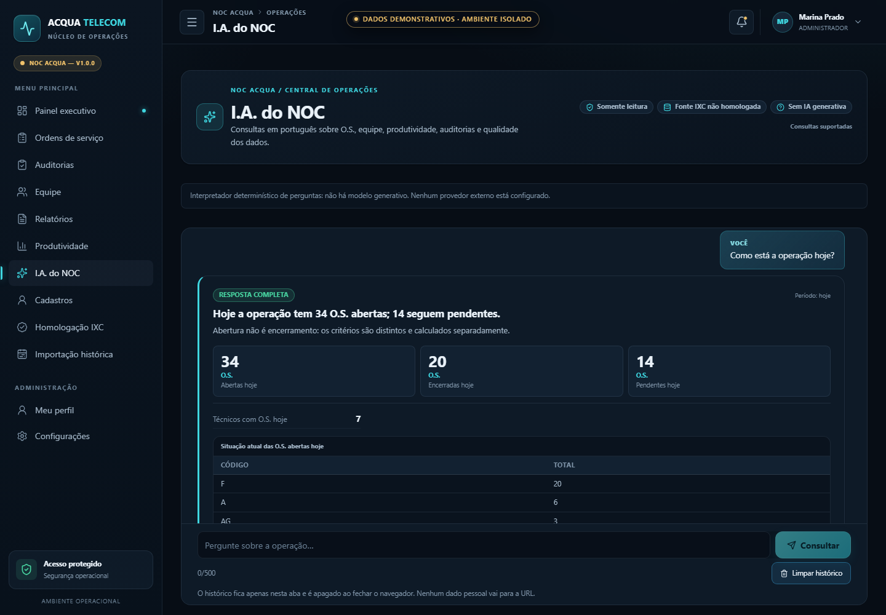

### As sete telas em 390 px

As capturas acima foram feitas em 1440 × 1000. Reduzidas a 390 px, elas preservam a composição,
mas os indicadores deixariam de ser legíveis. Por isso, cada tela tem também uma captura nativa
nessa largura, feita no mesmo ambiente demonstrativo. A captura completa em 1440 px permanece
acima de cada módulo.

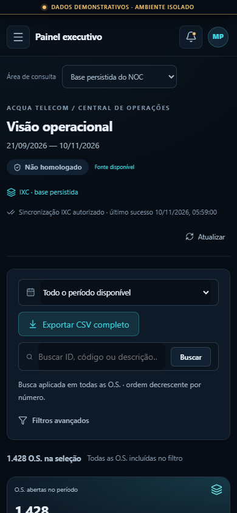 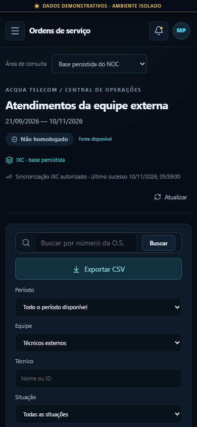
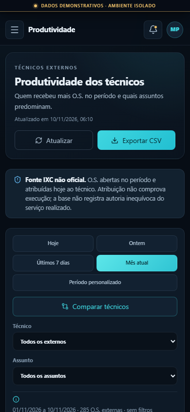 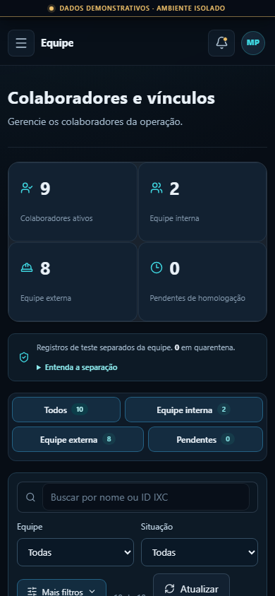
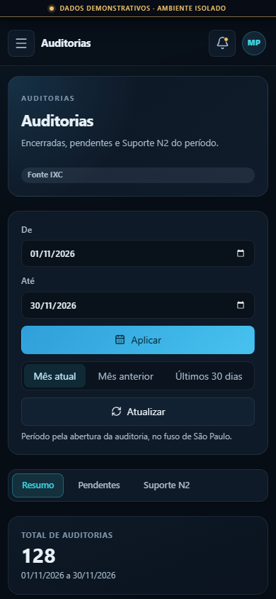 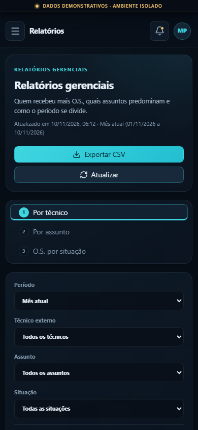
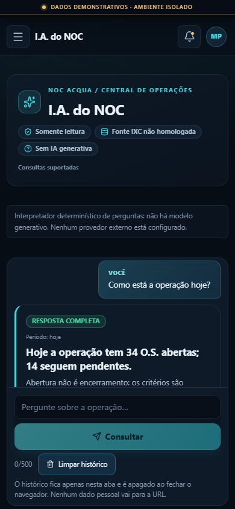

Telas complementares do ambiente demonstrativo: [Homologação IXC](capturas/09-homologacao-ixc.png),
[Meu perfil](capturas/08-meu-perfil.png) e [Autenticação](capturas/10-login.png).

## Como foi construído

As telas acima são a superfície de uma aplicação dividida em interface, API e banco de dados, com
uma integração de leitura com o IXC. Cada camada tem responsabilidade definida e contrato tipado
nas duas pontas.

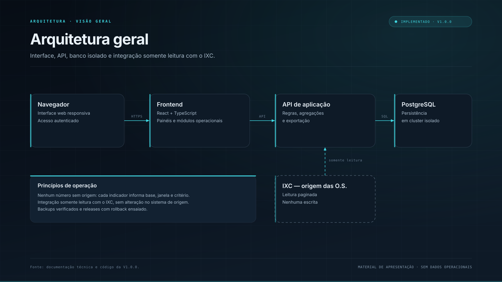

**Interface.** React com TypeScript sobre build Vite, com design system próprio em tokens CSS,
layout responsivo e foco visível por teclado.

**API.** Node.js com TypeScript e Express, responsável pelas regras de domínio, pela sessão, pelas
agregações e pela exportação.

**Banco.** PostgreSQL com migrações versionadas. Gravações de lote são atômicas: um lote
incompleto não substitui o último conjunto válido.

### Dentro das camadas

A interface reúne os módulos operacionais; a API expõe grupos de operação, produtividade,
auditorias, administração e sincronização; o banco persiste usuários, ordens, histórico, vínculos,
auditorias e catálogos.

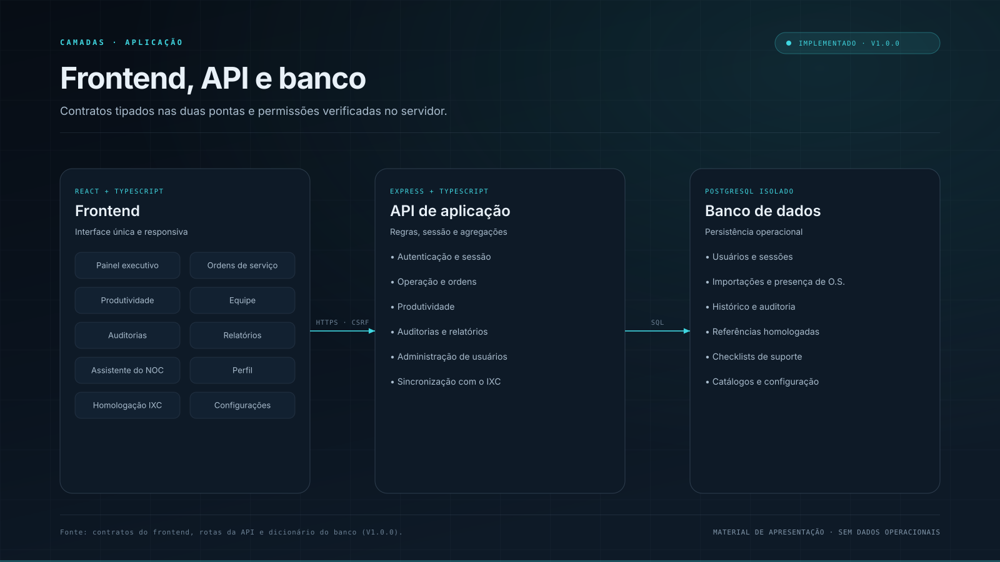

### Integração somente leitura

A coleta é periódica — na V1.0.0, a cada 15 minutos. O painel informa a última leitura e a origem
dos dados; atrasos da fonte, falhas de rede ou manutenções podem adiar a atualização. O sistema
não promete tempo real e não completa lacunas da fonte.

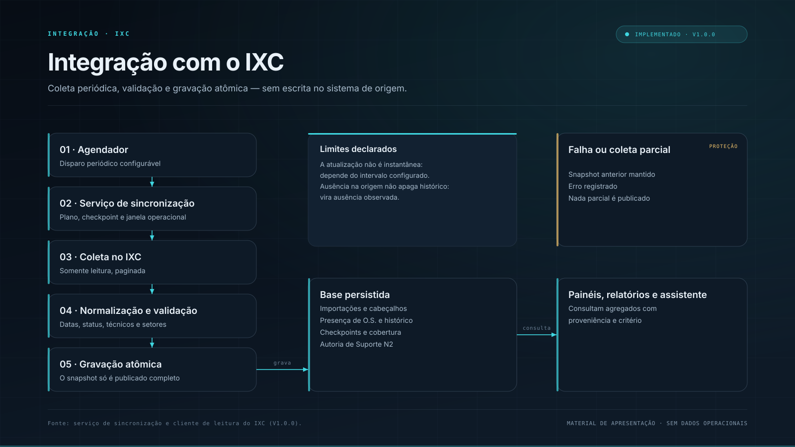

- **Leitura paginada** com limite de payload e checkpoint persistente, para coletas longas não
  recomeçarem do zero.
- **Gravação atômica por lote:** uma falha não publica um conjunto parcial nem apaga o anterior.
- **Reconciliação de ausências:** uma ordem que não aparece em uma coleta não é apagada nem
  tratada como encerrada.
- **Limites declarados:** o intervalo configurado aparece na tela, junto com a origem e o horário
  do dado.

### Acesso e segurança

O acesso é individual, com senha protegida por Argon2, segundo fator TOTP e sessão assinada. A
autorização é aplicada no servidor por permissão e por escopo de leitura, com cabeçalhos de
proteção, limite de taxa e eventos auditáveis. Os perfis separam administração, operação e
consulta; a interface esconde o que o usuário não pode fazer, mas a decisão é sempre da API.

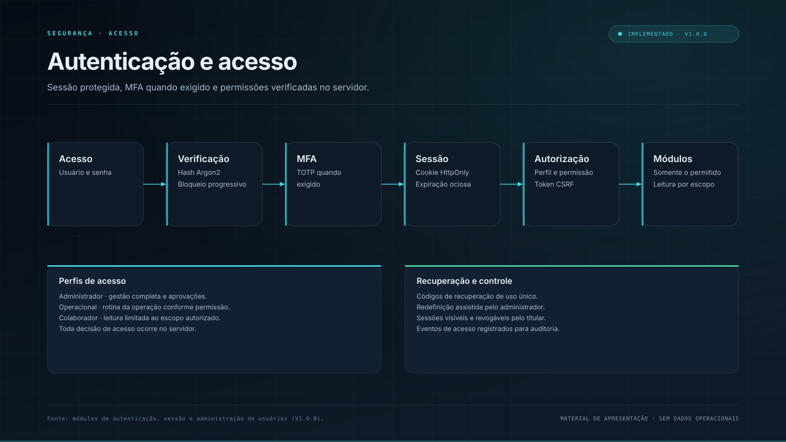

### Tecnologias

- **Interface** — React, TypeScript, Vite e design system próprio com tokens CSS.
- **API** — Node.js, TypeScript e Express.
- **Banco** — PostgreSQL com migrações versionadas.
- **Segurança** — Argon2, TOTP, sessão assinada, cabeçalhos de proteção e limite de taxa.
- **Integração** — cliente HTTP somente leitura, com paginação, limite de payload e checkpoint.
- **Qualidade** — testes de domínio, HTTP e interface; análise de tipos; axe; testes de navegador.
- **Operação** — serviço supervisionado com reinício automático e backup cifrado.
- **Release** — releases imutáveis com manifesto, verificação de hashes, ensaio e rollback.

## Desafios superados

Os problemas abaixo não são hipotéticos: cada um exigiu mudança de modelo, teste específico e
validação em ambiente isolado.

**Designação não é execução.** A origem informa o técnico atribuído, não necessariamente quem
encerrou a visita. O ranking é declarado por atribuição e não inventa autoria.

**Semântica da fonte.** Situações e assuntos só entram nos indicadores depois de homologados no
módulo de Homologação IXC. Descrição de catálogo não é tratada como regra de negócio.

**Ausência não é exclusão.** Coletas parciais e janelas de reconciliação tardia exigiram separar
presença, ausência e exclusão na origem. Uma ordem fora de uma coleta permanece no histórico até
que a fonte comprove o contrário.

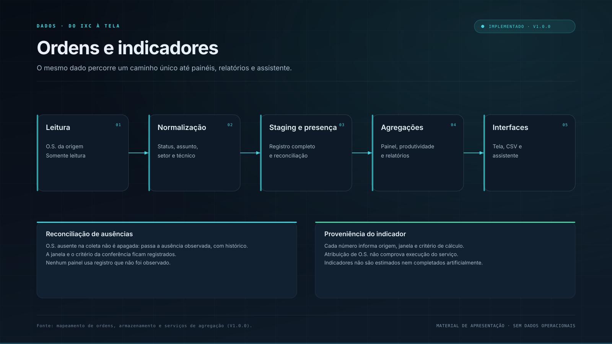

**Datas sem fuso inventado.** Os registros usam a data local da fonte; nenhuma conversão é
presumida para "corrigir" o horário.

**Consistência em escala.** Paginação, limites de payload, concorrência e gravação atômica mantêm
o conjunto coerente mesmo com coletas longas.

## Qualidade comprovada

O projeto preserva artefatos de teste e relatórios de validação. Os números abaixo vêm desses
artefatos e descrevem o que foi testado na versão estável:

- **728** testes automatizados aprovados no servidor.
- **55 de 55** rotas de escrita exercitadas.
- **0** erros de análise de tipos.
- **11** páginas com **0** violações axe (WCAG 2.0/2.1/2.2 AA).
- **0** falhas de contraste na varredura manual.
- **5** larguras validadas (1440/1024/768/390/320) sem estouro horizontal.
- **278 de 278** arquivos da release verificados por hash.
- **12 de 12** verificações do ensaio de release aprovadas.
- **Backup** com restauração conferida em ambiente isolado.

A release publicada é um conjunto imutável de arquivos com hashes verificáveis, ensaiado antes da
virada e reversível. O backup é automático e cifrado; a restauração foi verificada em ambiente
isolado, com tabelas e linhas conferidas. Rollback e recuperação fazem parte do desenho, não são
improvisados no incidente.

Os números comprovam o que foi testado. Eles não substituem acompanhamento contínuo de operação.

## O que vem depois

A V1.0.0 é a primeira entrega funcional estável de uma plataforma concebida para evoluir. **Nada
nesta seção está implementado:** cada frente é classificada como **PLANEJADO** (escopo definido,
sem implementação) ou **EM ESTUDO** (depende de viabilidade, orçamento, infraestrutura ou
autorização).

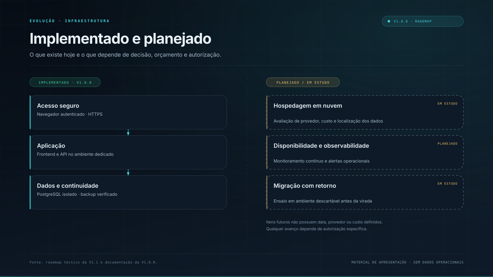

- **PLANEJADO — Estabilidade e confiabilidade.** Monitoramento contínuo, desempenho, sincronização
  e recuperação de falhas.
- **PLANEJADO / EM ESTUDO — Inteligência artificial.** Ampliar o assistente determinístico da
  V1.0; IA generativa avançada pertence ao roadmap futuro e segue em estudo, sem provedor definido.
- **EM ESTUDO — Domínio permanente.** URL HTTPS fixa e controles adicionais, conforme autorização.
- **EM ESTUDO — Hospedagem em nuvem.** Provedor, disponibilidade, custos e migração com retorno.
- **PLANEJADO — Escalabilidade.** Mais usuários, técnicos e volume sem perder rastreabilidade.
- **PLANEJADO / EM ESTUDO — Evolução funcional.** Novos módulos, indicadores e automações úteis ao
  suporte.

Itens futuros não têm data, provedor ou custo definidos. A leitura correta é: existe uma base
estável e mensurável, e existe um plano de evolução responsável — não um conjunto de recursos já
funcionando.

## Conclusão

**A necessidade.** Um centro de operações que decide com números precisa saber de onde cada
número veio. O registro de ordens de serviço já existia; a leitura gerencial rastreável, não.

**A solução.** A V1.0.0 entrega uma plataforma própria, integrada ao IXC em modo somente leitura,
com sete módulos operacionais, procedência declarada em cada indicador e lacuna explícita quando
a fonte não comprova o dado.

**Os desafios.** Separar designação de execução, homologar a semântica da fonte antes de usá-la,
distinguir ausência de exclusão e manter consistência em coletas longas exigiram mudança de
modelo, teste específico e validação isolada.

**Os aprendizados.** Três decisões se mostraram estruturantes: tratar a origem como contrato,
declarar o limite antes de calcular e ensaiar release, rollback e restauração como parte do
desenho — não como resposta a incidente.

**A perspectiva.** A V1.1+ é escopo separado, classificado entre planejado e em estudo, sem data,
provedor ou custo definidos. A base atual é estável e mensurável; a evolução será incremental e
comprovada como esta versão.

## Escopo e autoria

Projeto interno da **Acqua Telecom**. Código-fonte, dados operacionais, schema detalhado,
documentação interna e topologia de infraestrutura **não** fazem parte deste material. As telas
usam dados fictícios; as evidências são citadas como resultado, sem publicar os artefatos que as
contêm.

Todos os nomes de pessoas, técnicos e operadores são fictícios, criados para esta demonstração, e
não correspondem a clientes, colaboradores ou contas reais. A conta de demonstração usa o
identificador `gestor.demo` e o e-mail reservado `@exemplo.test`.

O trabalho envolve modelagem de domínio, autorização por permissão e escopo, integração somente
leitura com rastreabilidade, agregações conciliáveis, acessibilidade, release verificável, backup
com restauração comprovada e documentação viva.

Canal de contato: o perfil GitHub do responsável por este projeto.

[Voltar ao topo](#noc-acqua)
